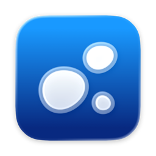
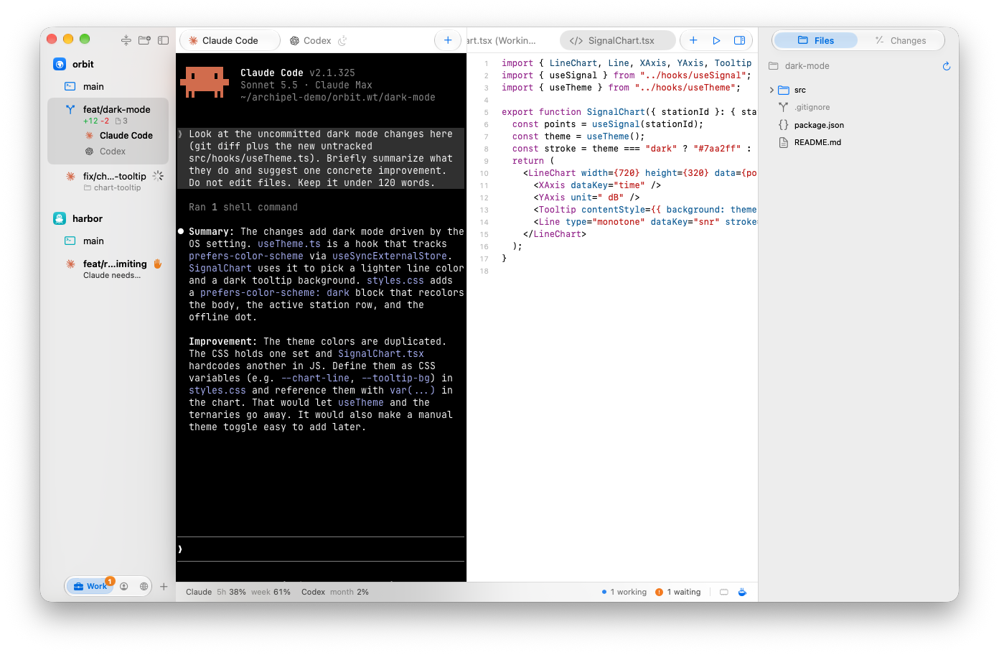

<div align="center">



# Archipel

A macOS app for running coding agents. Claude Code, Codex and plain shells run in
embedded Ghostty terminals, each in its own git worktree, with an Arc style sidebar
that shows what every agent is doing.


</div>


Running three or four agents at once usually means a pile of terminal tabs,
branches that get in each other's way and a lot of checking whether something
is done yet. In Archipel every task gets a worktree, every worktree gets its
sessions, and the sidebar shows which agent is working, which one is waiting for
you and which one has finished.

## Features

### Islands, projects and worktrees

- Work is grouped as islands > projects > worktrees. Switch islands with
  <kbd>Ctrl</kbd>+<kbd>1</kbd> to <kbd>9</kbd> or a two-finger swipe over the sidebar.
  Agents in other islands keep running, and the island gets a badge when one needs you.
- Create a worktree for a new branch from the sidebar. Worktrees you made with
  `git worktree` yourself are picked up too.
- Projects can have an icon and color, or use their GitHub avatar.
- Each project can have a setup script that runs in new worktrees (installing
  dependencies, copying `.env`) and a run script for <kbd>⌘</kbd><kbd>R</kbd>.

### Sessions

- Agents run in [Ghostty](https://ghostty.org) terminals that use your Ghostty
  config and your login shell environment.
- After a relaunch, agents resume the conversation they were in.
- Press <kbd>Space</kbd> in the sidebar to peek at the session under the pointer
  without switching to it.
- Drop files onto a session to paste their paths.
- When an agent starts a dev server, its URL shows up as a link on the tab.

### Notifications

- A worktree row lights up when its agent finishes or asks for input.
- Notifications have Allow, Deny and Reply buttons, so you can answer an agent
  without switching to Archipel. They are held back while you share your screen.
- The Dock icon gets a badge, and the menu bar icon lists every session, the ones
  waiting for you first. <kbd>⇧</kbd><kbd>⌘</kbd><kbd>U</kbd> jumps to the next one.
- Claude sessions show how many subagents they are running.

### Reviewing and committing



- Split the window into panes, each with tabs for sessions, files and diffs.
- Side-by-side diffs and an editor with syntax highlighting.
- Leave comments on diff lines and send them to an agent in one go.
- Stage, commit, push and pull from the Changes panel, and open a pull request
  through `gh`.
- Open a worktree or file in VS Code, Cursor, Zed, Xcode or another editor.

### Status bar

- Your Claude and Codex usage limits.
- Stay Awake, which keeps the Mac (and optionally the display) from sleeping while agents work.
- CPU and memory per terminal, including processes that kept running after
  their tab was closed.

## Keyboard shortcuts

| Action | Shortcut |
| --- | --- |
| Go to island, worktree, session or command | <kbd>⌘</kbd><kbd>K</kbd> |
| Open file quickly | <kbd>⌘</kbd><kbd>P</kbd> |
| New session with your default agent | <kbd>⌘</kbd><kbd>T</kbd> |
| New session with the other agents | <kbd>⌥</kbd><kbd>⌘</kbd><kbd>T</kbd>, <kbd>⇧</kbd><kbd>⌘</kbd><kbd>T</kbd> |
| Switch to recent tab | <kbd>Ctrl</kbd><kbd>Tab</kbd> |
| Next / previous tab | <kbd>⇧</kbd><kbd>⌘</kbd><kbd>]</kbd> / <kbd>⇧</kbd><kbd>⌘</kbd><kbd>[</kbd> |
| Split right | <kbd>⌘</kbd><kbd>\\</kbd> |
| Switch island | <kbd>Ctrl</kbd><kbd>1</kbd>...<kbd>9</kbd> |
| Next session needing attention | <kbd>⇧</kbd><kbd>⌘</kbd><kbd>U</kbd> |
| Add worktree | <kbd>⇧</kbd><kbd>⌘</kbd><kbd>N</kbd> |
| Add project | <kbd>⇧</kbd><kbd>⌘</kbd><kbd>O</kbd> |
| Run project | <kbd>⌘</kbd><kbd>R</kbd> |
| Commit | <kbd>⌥</kbd><kbd>⌘</kbd><kbd>C</kbd> |
| Show Files / Changes / toggle inspector | <kbd>⌥</kbd><kbd>⌘</kbd><kbd>1</kbd> / <kbd>2</kbd> / <kbd>0</kbd> |
| Open in external editor | <kbd>⇧</kbd><kbd>⌘</kbd><kbd>E</kbd> |

## Installation

Download `Archipel-<version>.dmg` from the
[releases](https://github.com/robertjndw/archipel/releases) and drag Archipel into
Applications.

### From source

**Requirements:** macOS 27, Xcode 27 and Zig 0.17 (`brew install zig`). You only need
the agents you want to use: [Claude Code](https://docs.anthropic.com/en/docs/claude-code) and/or
[Codex](https://github.com/openai/codex), plus the [GitHub CLI](https://cli.github.com)
for pull requests.

```sh
git clone https://github.com/robertjndw/archipel.git
cd archipel
./scripts/build-ghostty.sh   # once, and after bumping the Ghostty tag
./scripts/install.sh         # builds a Release copy into /Applications
```

Run `./scripts/install.sh` again to update. It quits and relaunches an installed
copy that is running, and leaves it untouched if the build fails. It replaces a
copy installed from a DMG too.

## How agent status works

Archipel starts each agent itself and injects what it needs per launch, so your own
agent configuration is never edited. Claude Code gets hooks through `--settings`;
Codex gets `notify` and approval notifications through `-c` overrides. Hooks call
`archipel-hook`, which forwards the event to the app over a Unix socket in
`~/Library/Application Support/Archipel`.

## Development

```sh
./scripts/build-ghostty.sh   # clones Ghostty at a pinned tag and builds GhosttyKit
open Archipel.xcodeproj      # then build and run the Archipel scheme
```

The script clones Ghostty into `Vendor/ghostty` and builds
`GhosttyKit.xcframework` plus Ghostty's runtime resources. Both are ignored by git.

### Signing

The project builds without an Apple Developer account: by default everything is
signed ad-hoc ("Sign to Run Locally"). macOS then treats each rebuild as a new app
and asks again for privacy permissions such as access to `~/Documents`. To sign
with your own team, copy `Configs/Local.xcconfig.example` to `Configs/Local.xcconfig`
(ignored by git) and fill in your team ID and a bundle id prefix of your own.

### Debug builds next to an installed copy

Debug builds are a separate app, "Archipel Dev" with the bundle id
`<bundle id>.debug`. They keep their own settings and their own workspace and hook
socket in `~/Library/Application Support/Archipel Dev`, so they can run next to an
installed release without touching its data.

Set `ARCHIPEL_SUPPORT_DIR` to run a build against a throwaway workspace file and
hook socket instead. Keep the path short, because Unix socket paths
are limited to about 100 bytes and agent status stops working beyond that.

```sh
open -n --env ARCHIPEL_SUPPORT_DIR=/tmp/archipel-dev path/to/Archipel.app
```

### Project layout

- `Archipel/` - the SwiftUI app. `Model/` is `AppModel` and `AppSettings`,
  `Services/` wraps system APIs (notifications, sleep, process stats), and
  `Views/` has a folder per feature. The Xcode groups follow the folders on
  disk, so new files are picked up without touching the project.
- `Packages/ArchipelKit` - `ArchipelCore` (model, status logic, persistence),
  `AgentKit` (agent launch commands, hook decoding, hook socket server),
  `GitKit` (async wrapper over git: status, staging, diffs, worktrees),
  `InspectorUI` (the Files and Changes sidebar), `EditorUI` (the file editor
  and the side-by-side diff view; syntax highlighting comes from highlight.js
  through the HighlighterSwift package) and the `archipel-hook` helper that
  agents call. Run `swift test` here. `editor-demo` opens an editor or diff
  in a window of its own.
- `Packages/TerminalKit` - the only code that talks to Ghostty. Includes
  `terminal-demo`, a one-window harness for testing a surface in isolation.
- `scripts/` - `build-ghostty.sh`, `install.sh` and `build-dmg.sh`, which the
  release workflow uses. See [docs/releasing.md](docs/releasing.md).
- `Configs/` - shared build settings and the optional `Local.xcconfig`.

## Acknowledgements

The terminals are [Ghostty](https://github.com/ghostty-org/ghostty). See
[`Packages/TerminalKit/THIRD_PARTY_NOTICES.md`](Packages/TerminalKit/THIRD_PARTY_NOTICES.md)
for third-party licenses.
